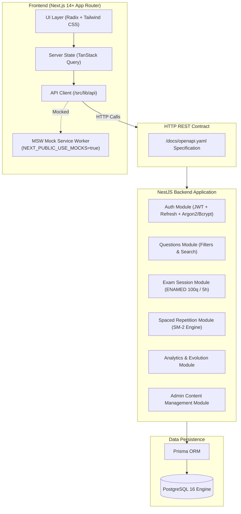

# MedLevel Architecture Specification

## 1. System Overview

MedLevel is a high-performance web platform designed specifically for Brazilian medical students preparing for the National Medical Assessment Exam (**ENAMED** - *Exame Nacional de Avaliação da Formação Médica*).

The platform provides:
- Categorized medical question bank with advanced filtering.
- Complete examination simulators (both official 100-question ENAMED mode and customizable mini-tests).
- Automated error notebook driven by the **SM-2 (SuperMemo 2)** spaced repetition algorithm.
- Real-time evolution metrics across medical core specialties.
- Dynamic study schedule generator tailored to individual weaknesses and target exam dates.
- Administrative content curation portal.

---

## 2. Medical Taxonomy & Data Model

The data layer is structured around the Brazilian official medical competency matrix for the five foundational specialties:
1. **Clínica Médica** (Internal Medicine)
2. **Cirurgia Geral** (Surgery)
3. **Pediatria** (Pediatrics)
4. **Ginecologia e Obstetrícia** (Obstetrics & Gynecology)
5. **Saúde Coletiva / Medicina de Família e Comunidade** (Public Health & Primary Care)

### Core Relational Entities:
- **`User`**: Medical students and administrators.
- **`Topic`**: Hierarchical knowledge tree (parent: Broad Area -> child: Medical Subspecialty / Subject).
- **`Question`**: Medical vignettes with year, source, difficulty, verification status, and clinical rationales.
- **`Alternative`**: 4 choices per question (A, B, C, D) with detailed justification.
- **`Attempt`**: Logged student response with timing in seconds, selected alternative, and correctness.
- **`ExamSession`**: Timed simulation instances with metadata (official 100 questions / 300 minutes or custom).
- **`ExamSessionQuestion`**: Ordered assignment of questions inside a specific test instance.
- **`ReviewCard`**: SM-2 spaced repetition record containing `easeFactor`, `interval`, `repetitions`, and `dueDate`.
- **`StudyPlan`**: Target examination date, weekly study hour commitment, and auto-generated daily goals.

---

## 3. Spaced Repetition Engine (SM-2)

When an attempt is registered as incorrect, a `ReviewCard` is created or reset:
- $EF' = EF + (0.1 - (5 - q) \cdot (0.08 + (5 - q) \cdot 0.02))$ where $EF \ge 1.3$.
- Repetition interval:
  - $I(1) = 1\text{ day}$
  - $I(2) = 6\text{ days}$
  - $I(n) = I(n-1) \cdot EF$ for $n > 2$.
- If rating $q < 3$ (failure): repetitions reset to $0$, interval reset to $1$ day.

---

## 4. Frontend Independence Architecture

To allow frontend development and end-to-end integration without a mandatory live database:
- The entire API contract is maintained in `/docs/openapi.yaml`.
- The frontend houses an abstraction layer in `/frontend/src/lib/api`.
- When `NEXT_PUBLIC_USE_MOCKS=true`, Mock Service Worker (MSW) intercepts all browser requests and delivers representative mock fixtures without network latency.
- In production or local integration with NestJS, standard HTTP calls connect to `NEXT_PUBLIC_API_URL`.

---

## 5. Security & Privacy (LGPD Compliance)

- **Authentication**: Access tokens (15-minute validity) + Refresh tokens (7-day validity stored securely).
- **Password Protection**: Salted Bcrypt hashing with standard 10 rounds.
- **Rate Limiting**: Throttler module active on sensitive authentication endpoints to prevent brute-force attacks.
- **LGPD**:
  - Explicit consent checkbox during registration.
  - Dedicated static Privacy Policy (`/privacidade`) and Terms of Service (`/termos`).
  - Self-service account deletion endpoint completely wiping personal records.
- **Medical Disclaimer**:
  - Prominent mandatory warning on all question views: *"Material de estudo. Não substitui diretrizes oficiais nem orientação clínica."*
